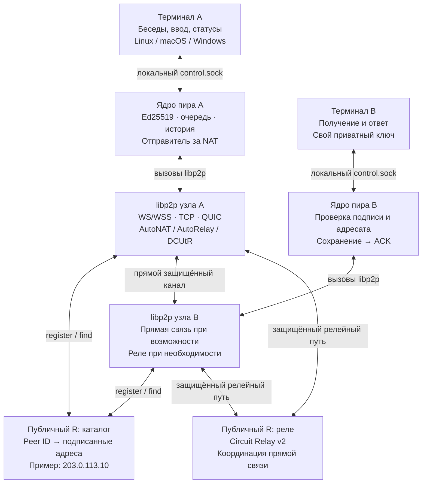
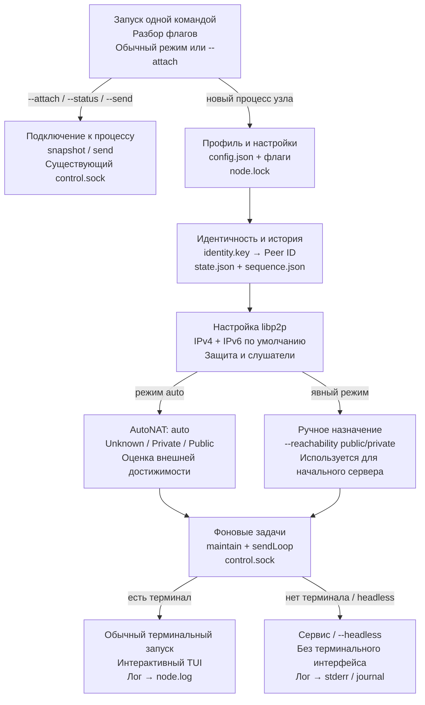
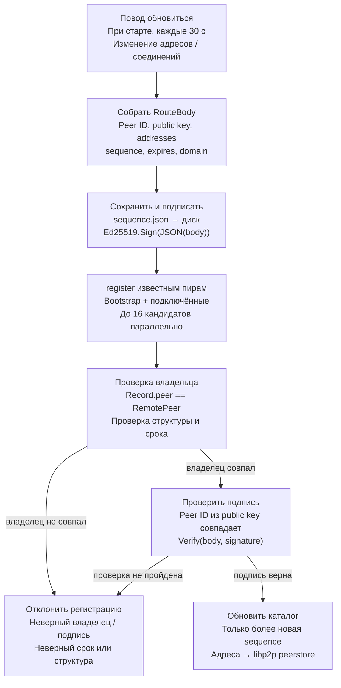
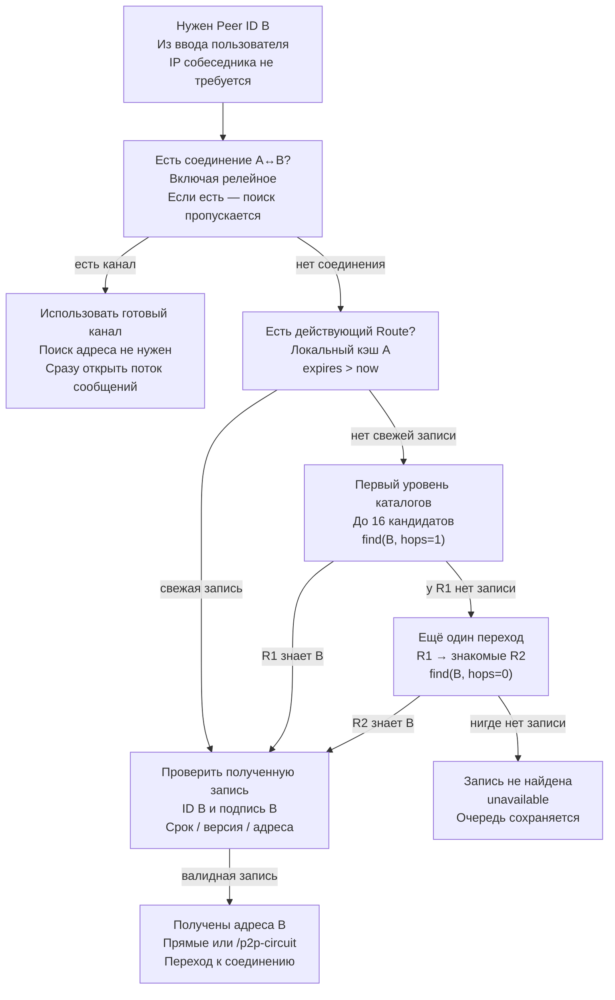
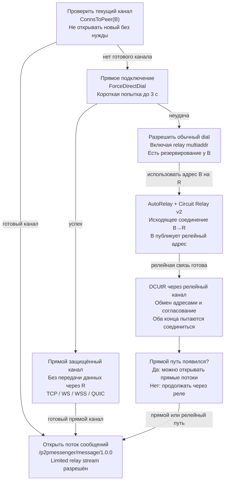
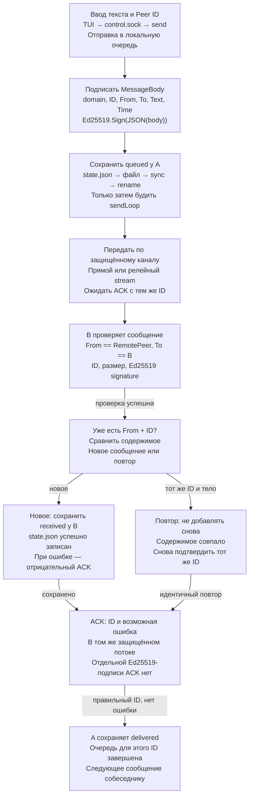
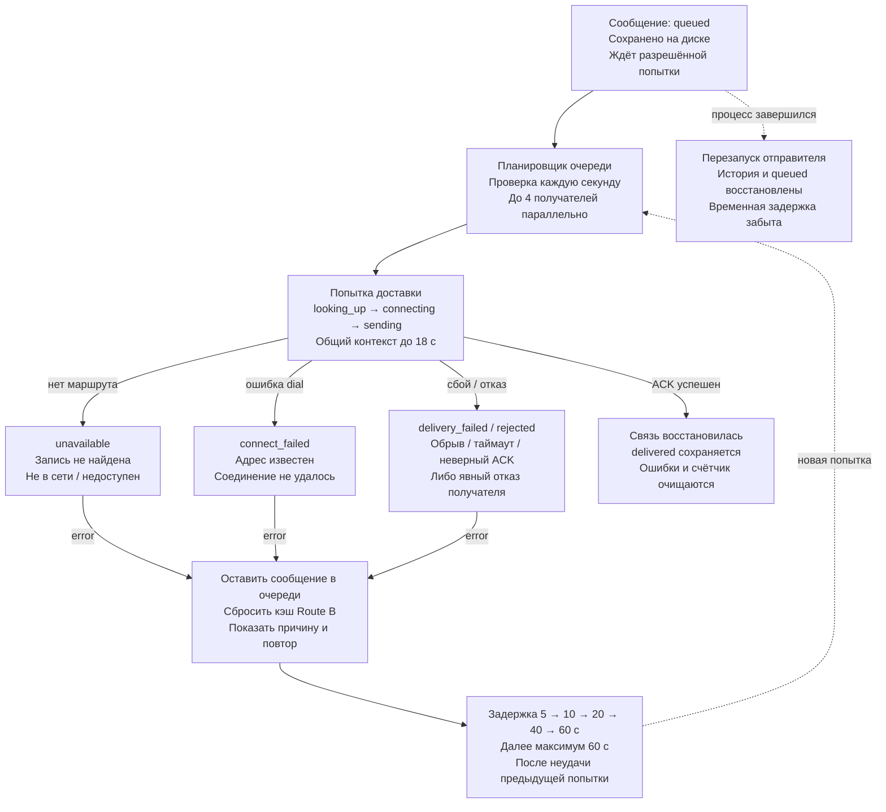
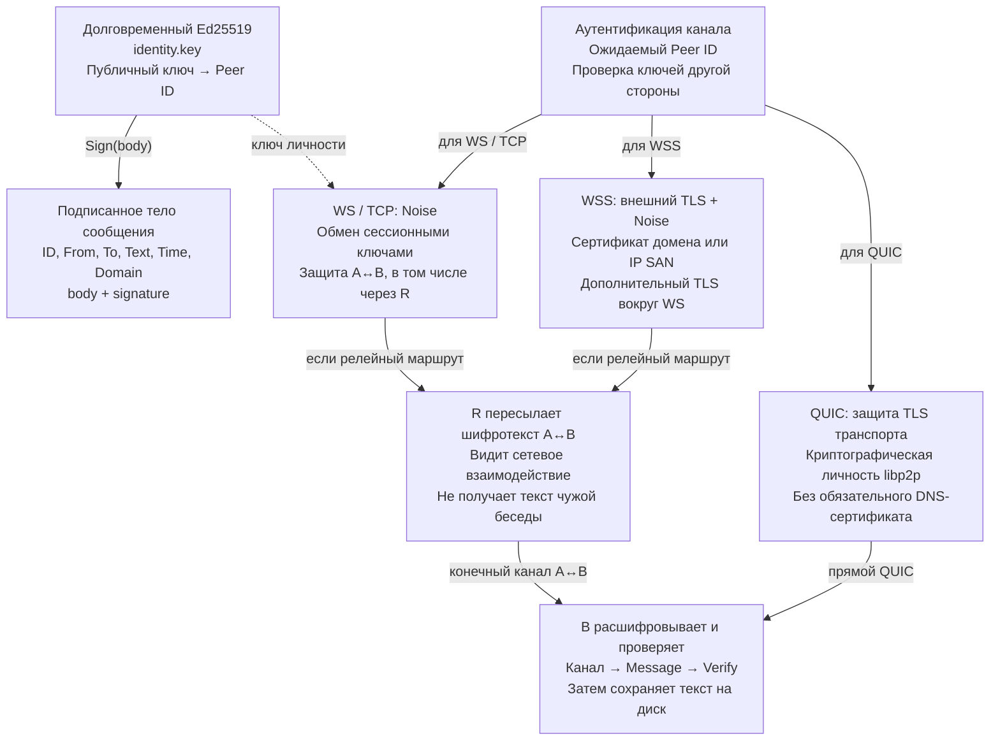
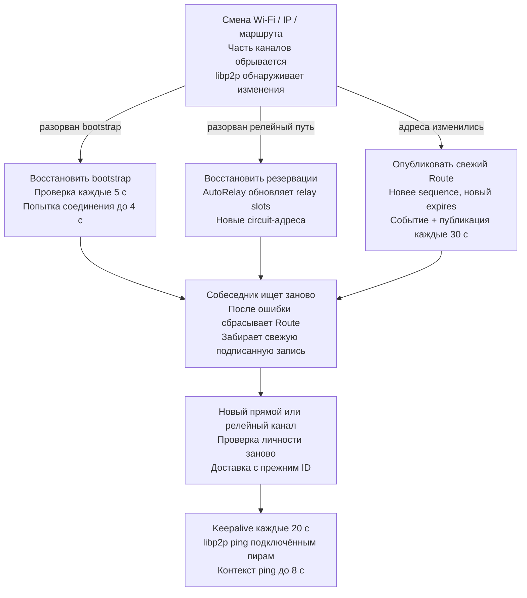

# Подробная логика мессенджера «Связь / P2P»

Описание текущего main.go. Откройте [интерактивную схему](architecture.html), чтобы переключать процессы, увеличивать диаграммы, нажимать блоки и сохранять отдельные SVG.

Сетевой протокол: `/p2pmessenger/directory/1.0.0` и `/p2pmessenger/message/1.0.0`.

## 01 · Сеть целиком

Каждый узел — полноценный пир с ключом и приложением. Публичный узел дополнительно помогает искать адреса и передавать шифротекст.



**Терминал A.** TUI отправляет локальные команды snapshot и send. Он не соединяется с чужим TUI. Основной запуск владеет сетевым узлом; --attach подключает дополнительный интерфейс к уже работающему процессу. Код: [newTerminalUI](../main.go#L1040).

**Ядро пира A.** Создаёт подписанное сообщение, сохраняет его в state.json, затем пытается доставить. Ключ хранится только у узла. При офлайне B сообщение остаётся у A. Код: [queue](../main.go#L471).

**libp2p узла A.** libp2p устанавливает аутентифицированные защищённые соединения. У скрытого узла исходящее соединение к публичному узлу обеспечивает путь для релейного подключения. Код: [run](../main.go#L1307).

**Публичный R: каталог.** Каталог возвращает адреса, но не расшифровывает сообщения между A и B. Роль каталога реализована приложением; технически обработчик есть у каждого пира. Пример сервера сейчас слушает WS на 80 и TCP/QUIC на 4002. Код: [handleDirectory](../main.go#L378).

**Публичный R: реле.** Это второй сервис того же публичного узла. Реле передаёт защищённое соединение A↔B и не является конечным получателем переписки. Если написать на Peer ID самого R, R уже становится адресатом и читает предназначенное ему сообщение. Код: [run](../main.go#L1307).

**Терминал B.** У B те же возможности, что у A. Для ответа роли отправителя и получателя меняются. Отдельного типа «только клиент» в программе нет. Код: [newTerminalUI](../main.go#L1040).

**Ядро пира B.** Обработчик проверяет From, To, ID и подпись; ищет уже принятое сообщение с тем же From+ID. Новое сообщение сохраняется до положительного ACK. Код: [handleMessage](../main.go#L429).

**libp2p узла B.** Входящий релейный канал позволяет начать общение и согласовать hole punching. Открытый прямой канал затем используется для новых потоков. Код: [run](../main.go#L1307).

- Peer ID — идентификатор по публичному ключу, а не IP-адрес. Для входа в неизвестную сеть нужен известный bootstrap.
- Прямая связь и реле — два пути одного приложения. Текст защищается между конечными пирами.
- На новом сервере пока показаны только IPv4 и IPv6 loopback ::1. Наличие [::]-слушателя не доказывает внешнюю IPv6-доступность.

## 02 · Запуск и роли

Сначала открываются профиль и ключ. Затем поднимается сеть, локальное управление и фоновые задачи.



**Запуск одной командой.** --attach, --status и --send обращаются к работающему процессу через его сокет и не запускают ещё один сетевой узел. Код: [run](../main.go#L1307).

**Подключение к процессу.** --attach открывает TUI, --status печатает JSON, --send ставит сообщение в очередь. Выход из подключённого интерфейса не останавливает службу. Код: [controlCall](../main.go#L853).

**Профиль и настройки.** Параметры командной строки заменяют только явно указанные поля сохранённой конфигурации. Блокировка не допускает двух владельцев одного профиля. По умолчанию профиль в ~/.local/share/p2pmessenger либо XDG_DATA_HOME. Код: [savedConfig](../main.go#L969).

**Идентичность и история.** Если ключа нет, генерируется Ed25519. Если есть — загружается прежний. История и очередь восстанавливаются из state.json; версия адресной записи берётся как максимум старого счётчика и sequence.json. Код: [loadKey](../main.go#L162).

**Настройка libp2p.** WS/WSS: по умолчанию 8081; серверу задан 80. TCP/QUIC: 4002, отключаются --direct-port 0. --ip-family задаёт входящие слушатели, но не является фильтром исходящих соединений. Код: [listenAddresses](../main.go#L933).

**AutoNAT: auto.** Без независимых проверяющих пиров статус может оставаться Unknown. Публичность определяется достижимостью, а не простым наличием адреса на интерфейсе. IPv4 и IPv6 могут иметь разную доступность; показан общий статус libp2p. Код: [run](../main.go#L1307).

**Ручное назначение.** public сразу объявляет узел публичным и позволяет включить relay service. Это решение оператора, а не результат внешней проверки. Именно так запущен первый публичный сервер. Код: [run](../main.go#L1307).

**Фоновые задачи.** maintain подключает bootstrap, обновляет регистрацию и отправляет ping. sendLoop обслуживает исходящую очередь. Оба работают независимо от интерфейса. Код: [maintain](../main.go#L679).

**Обычный терминальный запуск.** Если stdin и stdout — терминал и не задан --headless, открывается интерфейс. Его закрытие останавливает узел. Код: [terminalUI](../main.go#L1265).

**Сервис / --headless.** В systemd процесс работает без TUI. К нему можно открыть --attach из SSH. SIGTERM/SIGINT останавливают фоновые задачи; сохранённая очередь остаётся в профиле. Код: [run](../main.go#L1307).

- И Public, и Private могут отправлять и принимать личные сообщения. Public дополнительно может обслуживать Circuit Relay.
- Ни один профиль или ключ автоматически не копируется на другой компьютер. Каталог --data определяет вашу идентичность.

## 03 · Регистрация адресов

Пир подписывает свою адресную запись и отправляет её известным узлам. Каталог хранит её до истечения срока.



**Повод обновиться.** События libp2p объединяются задержкой 300 мс. После публикации по событию пробуждается очередь. Это асинхронное обновление, не мгновенная перестройка всей сети. Код: [maintain](../main.go#L679).

**Собрать RouteBody.** Domain равен p2pmessenger-route-v1. Берутся до 32 адресов host.Addrs(), затем сортируются. Номер версии — max(UnixNano, предыдущая+1). expires — текущее время + 3 минуты. Код: [localRoute](../main.go#L192).

**Сохранить и подписать.** Счётчик записывается отдельно, чтобы обновление адресов не переписывало историю. При ошибке диска публикация этой записи не выполняется. Публичный ключ содержится в самой записи. Код: [localRoute](../main.go#L192).

**register известным пирам.** В текущей версии все узлы имеют обработчик каталога. Публикация отправляется кандидатам; полной рассылки каждому участнику сети нет. На RPC выделяется до 5 секунд. Код: [publish](../main.go#L661).

**Проверка владельца.** register разрешён только от владельца записи на аутентифицированном libp2p-соединении. Domain, sequence, сроки, длины и multiaddr проверяются до сохранения. Код: [handleDirectory](../main.go#L378).

**Проверить подпись.** Подпись доказывает, кто заявил адрес. Она не доказывает, что адрес доступен извне: для этого нужны сетевые проверки. Срок не должен быть истёкшим или более чем на 5 минут в будущем по часам проверяющего. Код: [validateRoute](../main.go#L223).

**Отклонить регистрацию.** Возвращается ошибка register, запись не сохраняется. Более старая валидная версия отдельно игнорируется без замены актуальной записи. Код: [handleDirectory](../main.go#L378).

**Обновить каталог.** Равная или меньшая версия не заменяет сохранённую. Route лежит в памяти, адреса peerstore живут до expires. Просроченная запись не используется для lookup. После перезапуска каталог постепенно заполняется заново. Код: [remember](../main.go#L253).

- При ошибке проверки возвращается отказ; новая запись не сохраняется.
- Каталог ограничен 10 000 записями. При заполнении удаляются просроченные; если места всё равно нет, новая запись отклоняется.
- Топология меняется через свежие записи, переподключения и libp2p. Автоматической глобальной синхронизации всех каталогов нет.

## 04 · Поиск собеседника

Поиск — небольшой распределённый каталог с ограниченной глубиной, а не глобальная DHT.



**Нужен Peer ID B.** Peer ID проверяется синтаксически. Для сообщений ожидается ID со встроенным публичным ключом; наши узлы генерируют Ed25519. Код: [queue](../main.go#L471).

**Есть соединение A↔B?.** deliver сначала проверяет ConnsToPeer. При наличии соединения сразу открывается поток сообщений; запрос к публичному узлу на каждое сообщение не нужен. Код: [deliver](../main.go#L512).

**Использовать готовый канал.** Возможен прямой или релейный канал. Новый find не отправляется, если уже есть соединение к нужному Peer ID. Код: [deliver](../main.go#L512).

**Есть действующий Route?.** Если соединения нет, lookup сначала проверяет локальный кэш подписанных записей. После неудачной доставки запись B удаляется из кэша приложения. Код: [cached](../main.go#L278).

**Первый уровень каталогов.** Bootstrap и уже подключённые пиры опрашиваются параллельно. В кандидаты не включаются сам A и исключаемый отправитель запроса. Первый валидный ответ позволяет продолжить; остальные запросы отменяются. Код: [lookup](../main.go#L333).

**Ещё один переход.** Если R1 не знает B и hops=1, он запрашивает свои кандидаты, кроме A. R2 отвечает только из своего кэша: дальше поиск не распространяется. До 16 кандидатов на каждом уровне. Код: [handleDirectory](../main.go#L378).

**Проверить полученную запись.** Ответ каталога не принимается на веру. A проверяет Route, сохраняет допустимую запись и добавляет адреса в peerstore. Сам каталог не может подписать новый адрес от имени B без его ключа. Код: [remember](../main.go#L253).

**Получены адреса B.** Далее transport и libp2p проверяют, куда действительно можно подключиться. Адресный поиск и установление соединения — отдельные этапы. Код: [deliver](../main.go#L512).

**Запись не найдена.** Это может означать офлайн B, незарегистрированный адрес или недоступные каталоги. Код не умеет достоверно отличить все эти причины по отсутствию записи. Код: [lookup](../main.go#L333).

- Успешный кэш возвращается сразу, без обращений к каталогам. Существующий канал также используется сразу.
- Подписанная запись защищает происхождение данных, но не доступность каталога: каталог может не ответить или утаить запись.
- Поиск с двумя уровнями не гарантирует нахождение произвольного узла в очень большой сети.

## 05 · NAT, прямой канал и реле

Приложение выбирает маршрут, а механику пробивания NAT выполняет libp2p.



**Проверить текущий канал.** Если канал к B уже есть, deliver сразу открывает message stream. Канал может быть прямым или limited-релейным. Код: [deliver](../main.go#L512).

**Прямое подключение.** Приложение сначала просит libp2p использовать прямые адреса, запрещая релейный маршрут для этой попытки. Общий контекст попытки доставки ограничен 18 секундами. Код: [deliver](../main.go#L512).

**Прямой защищённый канал.** Успех зависит от доступности адреса, NAT и firewall. Глобальный IPv6 может дать прямой путь без IPv4 NAT, но firewall всё равно может блокировать входящие подключения. Код: [deliver](../main.go#L512).

**Разрешить обычный dial.** При неудаче прямой попытки вызывается обычный Connect с найденными адресами. Если есть /p2p/R/p2p-circuit, libp2p может построить маршрут A→R→B. Код: [deliver](../main.go#L512).

**AutoRelay + Circuit Relay v2.** Кандидаты AutoRelay берутся из --bootstrap. Цель — до 3 резерваций, но не больше числа bootstrap; boot delay 3 с, backoff 15 с. Продление резерваций делает библиотека. Простое исходящее соединение к R ещё не равно успешной резервации. Код: [run](../main.go#L1307).

**DCUtR через релейный канал.** Библиотека использует релейную связь для координации одновременного подключения. Публичный узел не может принудительно открыть произвольный NAT. Успех не гарантируется. Код: [run](../main.go#L1307).

**Прямой путь появился?.** Hole punching идёт средствами libp2p, а не отдельным циклом в нашем приложении. Уже открытый поток не следует считать мгновенно перенесённым на новый канал: прямое соединение позволяет использовать новые потоки. Код: [deliver](../main.go#L512).

**Открыть поток сообщений.** NewStream вызывается с WithAllowLimitedConn, поэтому сообщение можно передать по реле, пока прямой путь не получился. Если и релейный Connect не удался, сообщение остаётся в очереди. Код: [deliver](../main.go#L512).

- Реле обслуживается библиотекой с квотами. В go-libp2p v0.51.0 по умолчанию лимит circuit-соединения — 2 минуты и 128 KiB в каждом направлении; резервирование — до 1 часа с продлением.
- При --direct-port 0 дополнительные TCP/QUIC выключены. Работа через WS/WSS остаётся, но рассчитывать на успешное пробивание NAT нельзя.
- Автоматического подбора новых relay-кандидатов из глобальной DHT нет: AutoRelay использует список bootstrap.

## 06 · Доставка и подтверждение

Сообщение сначала сохраняется у отправителя. Положительный ACK означает сохранение у получателя.



**Ввод текста и Peer ID.** Проверяются адресат, отсутствие отправки самому себе и размер 1–16 000 байт. Для ID берутся 16 случайных байт, отображаемые 32 hex-символами. Код: [queue](../main.go#L471).

**Подписать MessageBody.** Domain равен p2pmessenger-message-v1. Время — Unix milliseconds. Signature передаётся рядом с body; текст подписывается до помещения в очередь. Код: [queue](../main.go#L471).

**Сохранить queued у A.** При ошибке сохранения добавление откатывается и TUI получает ошибку. Очередь и история лежат на диске без локального шифрования. На Windows синхронизация каталога пропускается; сам временный файл синхронизируется. Код: [atomicWrite](../main.go#L127).

**Передать по защищённому каналу.** На I/O сообщения и ACK выставляется до 10 секунд, ограниченных остатком общего контекста. Отмена контекста сбрасывает поток. ID ACK должен совпадать с ID сообщения. Код: [deliver](../main.go#L512).

**B проверяет сообщение.** Ключ отправителя извлекается из аутентифицированного Peer ID. Подмена текста, адресата или ID делает подпись неверной. Время подписано, но не используется как механизм дедупликации или срок годности. Код: [validateMessage](../main.go#L411).

**Уже есть From + ID?.** Если тот же From+ID уже принят, содержимое должно совпасть целиком. Идентичный повтор получает ACK без добавления в историю. Другое содержимое с тем же ID отклоняется как collision. Код: [handleMessage](../main.go#L429).

**Новое: сохранить received у B.** Если история полна или диск не сохранил сообщение, B не подтверждает успех. received означает принятие узлом, не прочтение человеком. Код: [handleMessage](../main.go#L429).

**Повтор: не добавлять снова.** Этот путь нужен, если первый ACK потерялся или A не сохранил статус delivered. Защита действует, пока принятый ID сохранён в истории B. Код: [handleMessage](../main.go#L429).

**ACK: ID и возможная ошибка.** ACK защищён аутентифицированным каналом. Положительный ACK отправляется после сохранения B либо после распознавания идентичного повтора. При сбое передачи ACK отправитель попробует снова. Код: [handleMessage](../main.go#L429).

**A сохраняет delivered.** A проверяет ID и отсутствие Ack.Error. При неудаче записи своего состояния статус откатывается; повтор с тем же ID безопасно обрабатывается B. Код: [sendLoop](../main.go#L591).

- Ошибка валидации, collision, заполненная история или ошибка записи дают отрицательный ACK. Повреждённый JSON может привести к сбросу потока без ACK.
- Нет ACK, неверный ID ACK или Ack.Error не означают успешную доставку. Исходящее остаётся queued.
- Это повторы с дедупликацией по сохранённым ID, а не универсальная гарантия «exactly once» при удалении истории, восстановлении старой резервной копии или потере диска.

## 07 · Офлайн, ошибки и повторы

Сохраняемый статус сообщения и временный статус соединения — разные вещи.



**Сообщение: queued.** queued остаётся в state.json до положительного ACK и успешного сохранения delivered. Состояния looking_up/connecting/sending хранятся только в памяти и показываются через snapshot. Код: [sendLoop](../main.go#L591).

**Планировщик очереди.** Сообщения группируются по получателю и идут по очереди внутри одной беседы. В одном проходе планировщик ждёт завершения выбранных задач. Сеть с большим числом недоступных получателей может ждать слотов; это не безлимитная параллельность. Код: [sendLoop](../main.go#L591).

**Попытка доставки.** Прогресс виден в TUI. Если уже есть соединение, lookup не нужен. Старые ошибочные сообщения одному получателю останавливают отправку следующих до успешного повтора. Код: [deliver](../main.go#L512).

**unavailable.** Причиной может быть офлайн получателя, отсутствие регистрации или недоступные каталоги. Это не достоверное утверждение, что устройство выключено. Код: [peerDeliveryLabel](../main.go#L787).

**connect_failed.** Например, адрес устарел после смены сети, входящее подключение блокируется или нет рабочего реле. Код: [peerDeliveryLabel](../main.go#L787).

**delivery_failed / rejected.** delivery_failed относится к передаче и подтверждению. rejected — получен Ack.Error: например, история B заполнена или запись на его диск не прошла. Код: [peerDeliveryLabel](../main.go#L787).

**Оставить сообщение в очереди.** Для B увеличивается счётчик неудач. NextAttempt и детали ошибок временные; текст последней ошибки сообщения сохраняется в state.json. По F2 можно увидеть техническую причину. Код: [deliver](../main.go#L512).

**Задержка 5 → 10 → 20 → 40 → 60 с.** Планировщик проверяет срок раз в секунду. Добавление нового сообщения не обходит уже назначенную задержку для того же получателя. Срок — ориентир, а не гарантия запуска точно в миллисекунду. Код: [retryDelay](../main.go#L773).

**Связь восстановилась.** Успешная доставка очищает failure state. Для отображения «на связи» дополнительно проверяется фактическое соединение; успех в прошлом не делает B вечно онлайн. Код: [snapshot](../main.go#L824).

**Перезапуск отправителя.** После запуска queued снова обрабатывается без восстановления старого backoff. Подпись и ID сообщения остаются прежними. Чтобы сообщение пришло после офлайна B, A тоже должен снова работать. Код: [run](../main.go#L1307).

- Сам факт отсутствия соединения не используется как доказанный офлайн. Нет отдельного глобального presence-протокола.
- Получатель не хранит чужие офлайн-сообщения как почтовый сервер. Релейные узлы также не являются офлайн-почтой.

## 08 · Подписи и шифрование

Долговременный ключ удостоверяет личность и сообщение. Сессионная криптография защищает канал.



**Долговременный Ed25519.** Ключ сохраняется в профиле и переживает перезапуски. Владение приватным ключом позволяет выдавать себя за этот Peer ID. Закрытый ключ не рассылается собеседникам или каталогу. Код: [loadKey](../main.go#L162).

**Подписанное тело сообщения.** Подпись не шифрует текст. В памяти приложения и локальном state.json тело читаемо. Проверка подписи связывает содержимое сообщения с ключом отправителя. Код: [validateMessage](../main.go#L411).

**Аутентификация канала.** Даже если адрес получен от каталога, libp2p устанавливает связь с ожидаемой криптографической идентичностью. Каталог не может просто подменить B на другой ключ без ошибки соответствия Peer ID. Код: [run](../main.go#L1307).

**WS / TCP: Noise.** В коде явно выбран libp2p.Security(noise.ID, noise.New). Механизм обмена ключами и шифрования каналов реализован библиотекой; отдельный самодельный X25519-протокол для каждого сообщения не добавлялся. Код: [run](../main.go#L1307).

**WSS: внешний TLS + Noise.** WSS включается --tls-cert и --tls-key. Проверка сертификата на клиенте включена. Наличие DNS-имени само по себе не включает TLS; HTTP-редирект не может заменить TLS handshake. На релейном маршруте внешний WSS-TLS завершается на принимающем WebSocket узле R на соответствующем отрезке. Внутренний Noise между A и B продолжает защищать конечный поток через реле. Код: [run](../main.go#L1307).

**QUIC: защита TLS транспорта.** Для прямого QUIC защита является частью транспорта. Это не HTTPS/HTTP3-сервис только из-за использования QUIC и не требует публичного домена с веб-сертификатом. Код: [run](../main.go#L1307).

**R пересылает шифротекст A↔B.** У R есть собственные соединения с участниками и служебные данные для маршрутизации. Содержимое конечного защищённого канала A↔B ему недоступно. IP, объёмы и время трафика не скрываются как в анонимной сети. Код: [run](../main.go#L1307).

**B расшифровывает и проверяет.** После транспортного расшифрования приложение проверяет подпись MessageBody. Это два разных уровня защиты. Приватный ключ подписи не используется как ключ шифрования текста напрямую. Код: [handleMessage](../main.go#L429).

- Сейчас сервер 203.0.113.10 запущен с WS на 80: внешнего веб-TLS на этом пути нет, но содержимое libp2p-канала защищено Noise.
- Нет Double Ratchet / Signal-протокола, отдельного шифрованного офлайн-конверта, защиты истории на диске и криптографического аудита приложения.
- ACK не имеет отдельной подписи Ed25519: он защищён текущим аутентифицированным каналом. Нет статуса «прочитано».
- Личность человека зависит от того, какой Peer ID вы получили. Программа проверяет ключ относительно ожидаемого ID, но не доказывает принадлежность ID конкретному человеку по имени.

## 09 · Смена адреса и поддержание связи

Обновления адресов, резервации и keepalive поддерживают достижимость, но не гарантируют непрерывность при любой смене сети.



**Смена Wi-Fi / IP / маршрута.** Событие может появиться не мгновенно. При смене NAT старое сопоставление порта может исчезнуть; сохранённое соединение в интерфейсе ещё может потребовать проверки реальной отправкой. Код: [maintain](../main.go#L679).

**Восстановить bootstrap.** Если к bootstrap уже есть соединение, повторный dial не выполняется. При нескольких bootstrap попытки выполняются параллельно. Код: [maintain](../main.go#L679).

**Восстановить резервации.** Библиотека поддерживает релейные резервации и меняет адреса host. Появление /p2p-circuit в списке адресов показывает релейный путь; один dial к публичному R сам по себе этого не доказывает. Код: [run](../main.go#L1307).

**Опубликовать свежий Route.** Обновление доходит до известных кандидатов. Старые записи остаются до обновления или истечения TTL; нет мгновенного broadcast каждому пиру в мире. Код: [publish](../main.go#L661).

**Собеседник ищет заново.** Отправитель повторяет попытку по расписанию. Изменение адреса не меняет Peer ID или ключ, поэтому адресат беседы остаётся тем же. Код: [deliver](../main.go#L512).

**Новый прямой или релейный канал.** Приложение не полагается только на IP: другой процесс на старом адресе должен пройти проверку ожидаемого Peer ID. Сохранённые queued-сообщения отправляются в новый канал. Код: [deliver](../main.go#L512).

**Keepalive каждые 20 с.** Ping отправляется каждому подключённому Peer ID, в том числе bootstrap и собеседникам; разрешены limited-релейные соединения. Это попытка сохранить используемую связь, а не отдельный ping всем когда-либо известным контактам. Код: [maintain](../main.go#L679).

- Ping к R не означает поддержание любого отдельного NAT-сопоставления для B. Поддерживать нужно используемый путь.
- При нескольких соединениях к одному Peer ID код не гарантирует отдельный keepalive по каждому физическому соединению: Ping выбирает поток средствами libp2p.
- IPv6 ::1 — только локальный адрес. Для реального IPv6-маршрута нужны глобальный адрес, маршрут и разрешающий firewall на обоих концах.

## JSON и протоколы на проводе

Это иллюстративные JSON с условными ID, ключами и подписями. Они передаются внутри libp2p-потоков, а не через HTTP REST. Подписываются байты JSON, которые Go encoding/json получает из типизированного body в фиксированном порядке полей; произвольная перестановка или сериализация в другом языке не является отдельным согласованным стандартом канонизации. Поля public_key и signature кодируются JSON как Base64. sequence, expires и time — целые числа; expires в секундах, time в миллисекундах. body.domain — метка протокола для разделения контекстов подписи, а не DNS-домен.

### Адресная запись Route

/p2pmessenger/directory/1.0.0

```json
{
  "op": "register",
  "record": {
    "body": {
      "domain": "p2pmessenger-route-v1",
      "peer": "PEER_ID_B",
      "public_key": "BASE64_LIBP2P_PUBLIC_KEY",
      "addresses": [
        "/ip4/203.0.113.10/tcp/80/ws",
        "/ip6/2001:db8::b/udp/4002/quic-v1"
      ],
      "sequence": 1793880000000000000,
      "expires": 1793880180
    },
    "signature": "BASE64_SIGNATURE"
  }
}
```

### Поиск адреса

/p2pmessenger/directory/1.0.0

```json
{
  "op": "find",
  "peer": "PEER_ID_B",
  "hops": 1
}
```

### Сообщение Message

/p2pmessenger/message/1.0.0

```json
{
  "body": {
    "domain": "p2pmessenger-message-v1",
    "id": "0123456789abcdef0123456789abcdef",
    "from": "PEER_ID_A",
    "to": "PEER_ID_B",
    "text": "Привет!",
    "time": 1793880000000
  },
  "signature": "BASE64_SIGNATURE"
}
```

### Положительный ACK

Ответ в том же message stream

```json
{
  "id": "0123456789abcdef0123456789abcdef"
}
```

### Отрицательный ACK

Ответ в том же message stream

```json
{
  "id": "0123456789abcdef0123456789abcdef",
  "error": "recipient history is full"
}
```

## Файлы профиля

| Файл / область | Содержимое | Назначение |
| --- | --- | --- |
| identity.key | Долговременный приватный Ed25519-ключ | Сохраняет Peer ID; не передаётся по сети. |
| state.json | Сообщения и сохранённые статусы | queued / delivered / received; текст и подпись; история без шифрования на диске. |
| sequence.json | Счётчик версии адресной записи | Небольшая запись при обновлении адресов. |
| config.json | Параметры запуска сети | Bootstrap, порты, TLS-пути, family и reachability; явные флаги переопределяют сохранённые поля. |
| control.sock | Локальный канал управления | snapshot / send; TUI, attach и CLI-команды. Это не интернет-API. |
| node.lock | Блокировка профиля | Защита от двух владельцев одного каталога. |
| node.log | Лог интерактивного процесса | У headless-процесса сообщения идут в stderr / systemd journal. |
| Память процесса | Route-кэш, peerstore, статусы попыток | Каталог приложения и backoff не являются постоянной глобальной базой сети. |

## Таймеры

| Механизм | Значение | Смысл |
| --- | --- | --- |
| Очередь | 1 с | Проверка queued с наступившим NextAttempt. |
| Повторы доставки | 5 → 10 → 20 → 40 → 60 с | Задержка после ошибки для конкретного собеседника. |
| Контекст доставки | 18 с | Включает поиск и попытки соединения; отмена сбрасывает message stream. |
| Первая прямая попытка | до 3 с | После неё можно использовать обычный dial с реле. |
| I/O сообщения и ACK | до 10 с | Не дольше остатка контекста доставки; обработчик B выставляет до 12 с. |
| Bootstrap maintenance | 5 с / dial до 4 с | Если соединение отсутствует. |
| Регистрация адресов | 30 с + события | События объединяются задержкой 300 мс. |
| TTL Route | 3 мин | Проверяющий отклоняет истёкший срок и срок более 5 мин в будущем. |
| Directory RPC | до 5 с | Обработчик до 8 с; дополнительный поиск до 5 с. |
| Keepalive | 20 с / контекст до 8 с | Подключённые пиры, а не весь каталог. |
| AutoRelay | цель до 3; boot delay 3 с; backoff 15 с | Не больше числа bootstrap; продление внутри libp2p. |

## Пределы

| Объект | Предел |
| --- | --- |
| Текст сообщения | 1–16 000 байт |
| Исходящая очередь | до 1 000 queued |
| История | до 10 000 записей; при заполнении новые сообщения отклоняются |
| Каталог | до 10 000 записей |
| Адреса в Route | 1–32; каждый до 2 048 символов |
| Bootstrap / кандидаты | до 16 bootstrap; до 16 кандидатов на уровень поиска |
| Параллельная доставка | до 4 получателей, по одному последовательному потоку задач на получателя |
| Обработчики | общий семафор до 64 для directory/message/local control |
| Размер входного JSON | лимит чтения 128 KiB; ACK до 4 096 байт |

## Ещё не реализовано

- Автоматическая регистрация публичных пиров в DNS и выпуск/продление сертификатов ACME.
- Глобальная DHT и поиск произвольной глубины.
- Хранение офлайн-почты на реле; сейчас очередь у отправителя.
- Групповые чаты, файловые вложения, разрешения контактов и блокировки спама.
- Шифрование локальной истории, отдельный message-level Double Ratchet и статусы прочтения.

## Внешние механизмы libp2p

При включении EnableHolePunching, EnableAutoRelayWithStaticRelays, EnableRelayService и EnableNATService приложение использует готовые механизмы библиотеки.

- [DCUtR](https://libp2p.io/docs/dcutr/)
- [Защищённые каналы](https://libp2p.io/docs/secure-channels-overview/)
- [Спецификация Circuit Relay v2](https://github.com/libp2p/specs/blob/master/relay/circuit-v2.md)

Пересобрать документы после изменения кода: `node docs/build-architecture.mjs`.
